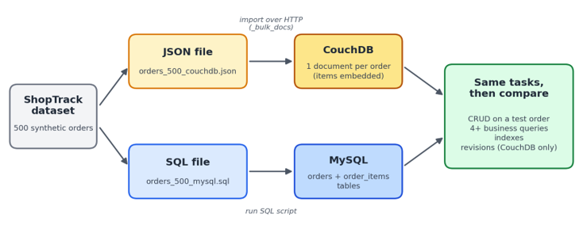

# Group 1 Project: ShopTrack on Apache CouchDB

**DATS 6102 – Data Warehousing | Fall 2026**
**Group 1 – Apache CouchDB**

**ShopTrack** is a simple order management system for a small online store, built on **Apache CouchDB**, a JSON document database accessed over HTTP/REST. The project loads the same 500 synthetic orders into CouchDB and into a normalized **MySQL** design, runs the same tasks on both, and compares the results. The final report also compares CouchDB with **MongoDB**.

## Team

| Member | Main task (project work) | Presentation (slides) | Live demo |
|---|---|---|---|
| Hassan Saleh H Alshamrani | Business problem, dataset, architecture diagram; CouchDB technical research (HTTP/REST, security, deployment, licensing); MongoDB comparison | Introduction, business problem, dataset; CouchDB vs. MongoDB | Add a new order over HTTP and display it |
| Damian Mendoza | Install CouchDB & MySQL, import data, set up MySQL tables; MySQL comparison: relational mapping (tables, primary/foreign keys, joins vs. embedded documents) | Data model: CouchDB documents vs. MySQL tables | Show loaded data in both databases; run the business queries in MySQL |
| Ingri Quevedo | Update/delete operations; CouchDB revisions and replication concepts; MySQL comparison: concurrency, transactions, consistency | CouchDB features (revisions/MVCC) vs. MySQL transactions and locking | Update and delete an order; show how revisions prevent overwriting |
| Stephanie Armstrong | Business queries (Mango selectors) and indexes; MySQL comparison: querying and indexing, performance; final recommendation | Queries and indexes; final recommendation | Run the business queries and show the indexes in CouchDB |

These responsibilities are subject to change. Every member will help with the whole project, understand all parts, and take part in the presentation and demo.

## Table of Contents

1. [Project Overview](#project-overview)
2. [Why CouchDB?](#why-couchdb)
3. [Dataset](#dataset)
4. [Architecture / Data Flow](#architecture--data-flow)
5. [Repository Structure](#repository-structure)
6. [Setup and Installation](#setup-and-installation)
7. [Data Model](#data-model)
8. [Loading the Data](#loading-the-data)
9. [CRUD Operations](#crud-operations)
10. [Indexes and Queries](#indexes-and-queries)
11. [CouchDB-Specific Feature Demo](#couchdb-specific-feature-demo)
12. [MySQL Comparison](#mysql-comparison)
13. [NoSQL Comparison](#nosql-comparison)
14. [Strengths, Limitations, and Use Cases](#strengths-limitations-and-use-cases)
15. [Security, Deployment, and Licensing](#security-deployment-and-licensing)
16. [Risks and Open Questions](#risks-and-open-questions)
17. [Demo Checklist](#demo-checklist)
18. [References](#references)

## Project Overview

- **Database:** Apache CouchDB, a document database (JSON documents, accessed over HTTP/REST)
- **Business problem:** ShopTrack tracks a small online store's orders through four stages: `processing`, `shipped`, `delivered`, and `cancelled`.
- **Intended users:** Store managers, who monitor order status across the store, and customer support staff, who need to find a customer's orders quickly and update them when something changes.
- **Dataset:** 500 synthetic orders (see [Dataset](#dataset))
- **Goal:** Show how a document-oriented, HTTP-based, revision-aware database handles order management differently from a normalized relational design in MySQL.

## Why CouchDB?

Each order is a self-contained record holding the customer, items, prices, address, and dates. CouchDB can store the whole order as a single JSON document and return it in one request by ID. The same data is also loaded into MySQL so both databases can be compared on identical tasks.

Key CouchDB concepts covered in this project:

- **Document model:** databases, documents, `_id`, and JSON structure
- **HTTP/REST interface:** all operations via `GET`, `PUT`, `POST`, `DELETE`
- **MVCC and revisions:** `_rev`-based optimistic concurrency, with no locking
- **Replication:** incremental, multi-directional, supports offline-first design
- **Querying:** Mango selectors and indexes
- **Security:** authentication, admin/user roles, deployment options

## Dataset

The dataset is synthetic (dummy) data. Its structure and product examples are based on a public sample orders dataset (JSONSift), and all orders were generated for practice, so there is no real customer data and no privacy concern.

| Item | Value |
|---|---|
| CouchDB file | `orders_500_couchdb.json` |
| MySQL file | `orders_500_mysql.sql` |
| Orders | 500 (125 in each status) |
| Customer IDs | 80 |
| Products | 8 |
| Order items | 1,520 |
| Cities | Austin, Boston, Chicago, San Francisco, Seattle |

**Key fields:** `id`/`_id`, `userId`, `status`, `items` (`sku`, `name`, `quantity`, `unitPrice`), `subtotal`, `tax`, `shipping`, `total`, `shippingAddress`, `createdAt`, `deliveredAt`, `currency`, `dataOrigin`.

**Preparation:** The files are already prepared. Each file is imported once to avoid duplicates, and after import the group verifies that both databases contain exactly 500 orders. *(Imports not yet tested.)*

## Architecture / Data Flow



The ShopTrack dataset (500 synthetic orders) is split into a JSON file, imported into CouchDB over HTTP via `_bulk_docs`, and a SQL file, run as a script into MySQL. The same tasks are then run on both databases and compared: CRUD on a test order, 4+ business queries, indexes, and revisions (CouchDB only).

## Repository Structure

Planned layout (will be updated as implementation progresses):

```
.
├── README.md
├── docs/
│   ├── 1_DATS6102_Final_Group_Project_Class_Overview.pdf
│   ├── 2_DATS6102_Group1_Apache_CouchDB_Supplement.pdf
│   ├── DATS 6102_ Group 1 - Project Proposal.docx
│   ├── images/
│   │   └── architecture.png     # Architecture / data-flow diagram
│   ├── data-model.md            # Document design and embed-vs-reference rationale
│   ├── mysql-comparison.md      # Relational mapping and comparison
│   ├── nosql-comparison.md      # CouchDB vs MongoDB
│   └── final-report.pdf
├── data/
│   ├── orders_500_couchdb.json  # CouchDB bulk-load file
│   └── orders_500_mysql.sql     # MySQL tables + inserts
├── code/
│   ├── load_data.*              # Bulk load into CouchDB
│   ├── crud_examples.*
│   ├── queries/                 # Mango query JSON files
│   └── indexes/                 # Index definitions
├── presentation/
│   └── slides.pdf
└── screenshots/
```

## Setup and Installation

### Prerequisites
- Apache CouchDB ([install guide](https://docs.couchdb.org/en/stable/install/index.html)) or Docker
- MySQL Server (and MySQL Workbench or the `mysql` CLI)
- `curl` (and optionally `jq`, Python 3.x)

### Option A: Docker
```bash
docker run -d --name couchdb \
  -p 5984:5984 \
  -e COUCHDB_USER=admin \
  -e COUCHDB_PASSWORD=<your-password> \
  couchdb:latest
```

### Option B: Native Install
Follow the OS-specific instructions in the CouchDB docs, then start the service.

### Verify
```bash
curl http://admin:<password>@localhost:5984/
```
Fauxton (web UI): http://localhost:5984/_utils

> **Note:** Never commit real credentials. Use environment variables or a `.env` file (git-ignored).

## Data Model

### CouchDB
One database with **one document per order**. The `_id` is the order number (e.g., `syn_ord_0001`). Items and the shipping address are **embedded** in the order document because they are always viewed together with the order.

**Document shape (illustrative; field names follow the dataset):**
```json
{
  "_id": "syn_ord_0001",
  "userId": "...",
  "status": "shipped",
  "items": [
    { "sku": "...", "name": "...", "quantity": 2, "unitPrice": 0.00 }
  ],
  "subtotal": 0.00,
  "tax": 0.00,
  "shipping": 0.00,
  "total": 0.00,
  "currency": "USD",
  "shippingAddress": { "city": "Boston" },
  "createdAt": "...",
  "deliveredAt": null,
  "dataOrigin": "synthetic"
}
```

### MySQL (for comparison)
Two tables linked by order ID (primary key / foreign key):
- `orders`: one row per order
- `order_items`: one row per item

The model may be refined once implementation begins.

## Loading the Data

```bash
# Create the database
curl -X PUT http://admin:<password>@localhost:5984/<dbname>

# Bulk load (run once to avoid duplicates)
curl -X POST http://admin:<password>@localhost:5984/<dbname>/_bulk_docs \
  -H "Content-Type: application/json" \
  -d @data/orders_500_couchdb.json

# Verify the count (expect 500)
curl http://admin:<password>@localhost:5984/<dbname>
```

```bash
# MySQL
mysql -u <user> -p < data/orders_500_mysql.sql
```

## CRUD Operations

CRUD is demonstrated on a test order.

| Operation | Example |
|---|---|
| **Create** | `PUT /<db>/<docid>` or `POST /<db>` |
| **Read** | `GET /<db>/<docid>` |
| **Update** | `PUT /<db>/<docid>` with the current `_rev` |
| **Delete** | `DELETE /<db>/<docid>?rev=<rev>` |

## Indexes and Queries

At least four business queries will be run in both CouchDB (Mango selectors + indexes) and MySQL (SQL). Query and index definitions will be added to `code/queries/` and `code/indexes/`.

| # | Description | Type |
|---|---|---|
| 1 | TBD | |
| 2 | TBD | |
| 3 | TBD | |
| 4 | TBD | |

## CouchDB-Specific Feature Demo

**Feature demonstrated:** Document revisions (MVCC). Update an order with a stale `_rev`, show the `409 Conflict`, then resolve it, showing how revisions prevent overwriting.

## MySQL Comparison

| Topic | CouchDB | MySQL |
|---|---|---|
| How an order is stored | One JSON document with items inside | Split into `orders` and `order_items` tables |
| Getting a full order | One request by order ID | Join the two tables |
| Structure rules | Flexible; documents can differ | Fixed schema with keys |
| Handling changes | Each document has a revision number (`_rev`) | Transactions and locking |

**Preliminary expectations:**
- CouchDB is expected to be simpler for saving and reading complete orders.
- MySQL is expected to be stronger for reports across many orders.
- The final recommendation will be made after testing.

## NoSQL Comparison

CouchDB vs **MongoDB** across data model, querying, relationships, consistency/transactions, scaling, and use-case fit. *(To be completed.)*

## Strengths, Limitations, and Use Cases

**Strengths:** HTTP/JSON API, multi-master replication, offline-first sync, built-in MVCC, simple operation
**Limitations:** no multi-document transactions, no joins, limited ad hoc aggregation, conflict resolution is the application's job
**Common use cases:** offline-first mobile/web apps, distributed data sync, content/catalog stores, edge deployments

## Security, Deployment, and Licensing

- **Authentication:** TBD (basic auth / cookie / JWT, admin vs. member roles)
- **Deployment options:** single node, cluster, Docker, cloud-hosted
- **License:** Apache License 2.0

## Risks and Open Questions

**Risks:**
- **Installation problems:** Members use different computers, so CouchDB and MySQL setup may not behave the same for everyone.
- **Import errors:** Importing twice or into the wrong database could create duplicate or conflicting data. *Mitigation:* import once and verify the counts.
- **Learning CouchDB queries:** Mango selectors and indexes are new to the group and may take extra time.

**Questions for the instructor:**
- Should the MySQL design be fully normalized (e.g., add a `products` table), or is explaining that in the final report sufficient?
- Is demonstrating document revisions acceptable as the CouchDB-specific feature, or would replication be preferred?

## Demo Checklist

- [ ] Show the database and loaded JSON documents (500 orders in both databases)
- [ ] Add a new order over HTTP and display it
- [ ] Update and delete an order
- [ ] Show at least four business queries (incl. one multi-field retrieval) in CouchDB and MySQL
- [ ] Show the index/query structure
- [ ] Show document revisions preventing an overwrite

## References

- Apache CouchDB Documentation: https://docs.couchdb.org
- JSONSift sample orders dataset (structure and product examples for the synthetic data)

## License

Course project for DATS 6102.
